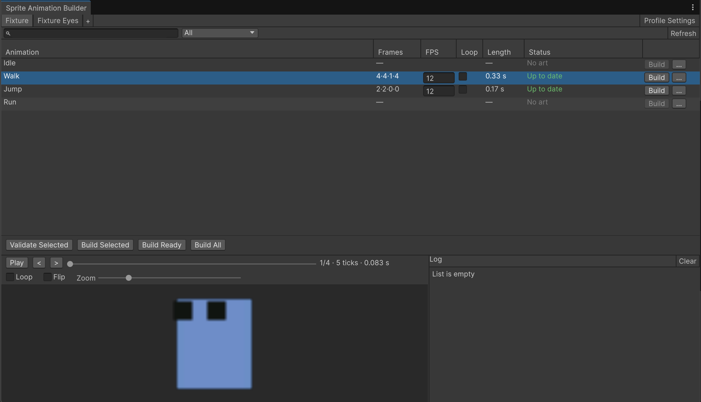
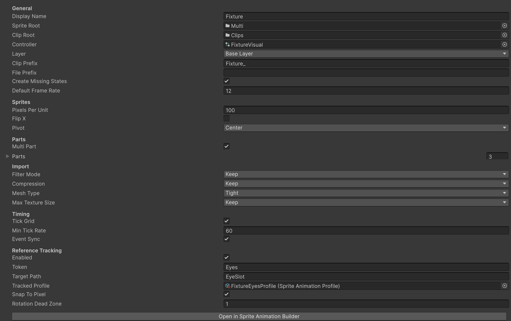

# MM Sprite Animation Builder
[](LICENSE.md)
[](https://unity.com/)
[](changelog.md)

_Sprite animation clips and Animator states from numbered PNG folders_

Put the frames of each animation in its own folder, point a profile at them and build. The
builder imports the sprites, writes one clip per folder, assigns it to the matching Animator
state and keeps track of which animations are new, changed or up to date.

Frame lengths adjusted in the Animation window survive rebuilds, and animation events stay on
their frames. Multi part characters, pivot modes and eye tracking are turned on per profile.

## Installation

Package Manager → **Add package from git URL**:

```
https://github.com/MertM0/MM_SpriteAnimationBuilder.git
```

Or add it to `Packages/manifest.json`:

```json
{
  "dependencies": {
    "com.mm.spriteanimationbuilder": "https://github.com/MertM0/MM_SpriteAnimationBuilder.git"
  }
}
```

Requires Unity 6000.0 or newer. Editor only, no dependencies.

Open **Tools → Sprite Animation Builder**, press **+** to create a profile, set its
**Sprite Root** and **Clip Root**, then add one folder per animation and press **Build All**:

```
Hero/
  Idle/  Idle_01.png  Idle_02.png  Idle_03.png
  Walk/  Walk_01.png  Walk_02.png  ...
```

`Walk/` becomes `Walk.anim` in the Clip Root and is assigned to the `Walk` state.

## Window



Each profile is a tab; drag tabs to reorder them. The order and the selected tab are kept per
user and per project, so they never change the profile assets.

### Rows and Status

A row is an animation found in the sprite folders or in the controller. **FPS** and **Loop** are
edited in place. Search by name or filter by status.

| Status | |
|---|---|
| **New** / **Changed** | Never built, or the frames or settings changed since the last build |
| **Up to date** | The clip matches the frames and settings |
| **Timing reset needed** | Custom timing no longer fits the frames, see [Timing Reset](#timing-reset) |
| **Invalid** | A problem with the frames, for example a gap in the numbering |
| **No state** | A folder without a state; a close state name is suggested |
| **No art** | A state without a folder; with an override controller it says so when the state still plays the base clip |

### Building

**Build Ready** builds new and changed rows, **Build All** every row that can be built,
**Build Selected** and **Validate Selected** the selection. Validate runs every check without
writing anything. The **...** menu of a row shows its sprite folder, selects or opens its clip in
the Animation window, validates it or resets its timing.

### Preview and Log

The preview plays, steps and loops the selected animation with its real timing and shows ticks,
seconds and events for the current frame. The log keeps the messages of the last builds; click one
to select its row.

## Profile



**Profile Settings** in the window and the Inspector of the profile asset show the same settings.
Settings of a feature that is turned off are hidden.

### Folders and Prefixes

**Sprite Root** holds one folder per animation, **Clip Root** receives the clips. Frames are
numbered from `01` without gaps; a misspelled case only warns.

`Clip Prefix` and `File Prefix` are added to clip and frame names: with `Hero_`, the `Walk`
folder expects `Hero_Walk_01.png` and writes `Hero_Walk.anim`. With a `Folder Prefix` only folders
starting with it are read and the prefix is dropped: `Hero_Walk/` becomes the `Walk` row.

### Controller

Optional. Without one, rows come from the sprite folders and only clips are written.

- **Animator Controller.** The clip becomes the motion of the state with the same name on the
  chosen **Layer**, including sub state machines. **Create Missing States** adds a state for a
  folder that has none.
- **Animator Override Controller.** States are read from the base controller and the clip
  overrides each state's original clip. Give every state its own placeholder clip; states that
  share one are overridden together.

### Variants

For several looks of the same character. A profile with **Variant Of** set reads the shared
settings (sprites, parts, import, timing, tracking, fallbacks, loop) from its base and keeps its own
roots, controller, prefixes and frame rates; an FPS left empty follows the base row. **Create
Override** makes the variant's override controller from the base controller.

A family shows as one tab with a strip of its members. **Overview** compares every member's rows,
**Build Family** builds the base first, then the variants. **Fallbacks** on the base
(`Spawn ← Fly_Start`) build a missing animation from another one's frames instead of letting the
state play the base character's clip.

### Sprites and Import

Every frame is imported as a single sprite without mipmaps, with the profile's **Pixels Per
Unit** and **Pivot**. **Filter Mode**, **Compression** and **Max Texture Size** are written only
when they are not **Keep**; **Mesh Type** defaults to Tight.

**Pivot** is Center, Bottom, Custom (a normalized point), or Anchor: the midpoint of two marks
drawn in the **Anchor Sprite**, so a part such as the eyes turns around that point.

## Parts

### Multi Part

For characters drawn on several sprite renderers. Each part has a token, the path of its renderer
and an optional flag, and its own subfolder. The first part sets the frame count; an optional part
may skip frames and shows nothing on them.

```
Walk/
  Body/  Walk_Body_01.png ... Walk_Body_08.png
  Arm/   Walk_Arm_03.png  Walk_Arm_04.png
```

### Reference Tracking

Moves a child transform, such as `EyeSlot`, so that a separately animated part follows the body.
Draw two marks per frame in a hidden `<Token>~` folder and set the **Tracked Profile**, whose
anchor sprite holds the same marks in their neutral place.

```
Walk/
  Body/   Walk_Body_01.png ...
  Eyes~/  Walk_Eyes_01.png ...
```

The builder writes the target's position, rotation and scale; a frame without marks hides it.
**Snap To Pixel** and **Rotation Dead Zone** keep small movements steady.

## Timing

### Tick Grid

With **Tick Grid** on, clips run on a fine grid of at least **Min Tick Rate** ticks per second
(12 fps → 60 ticks). Every frame starts with the same length, so nothing changes until you edit it.

To hold a frame longer, open the clip in the Animation window, select every key after it in the
summary row and drag them right. Rebuilding keeps that timing and changing the row's FPS scales
it. With **Tick Grid** off, clips have one key per frame.

### Events

Animation events stay on their frames. **Event Sync** moves them when keys are dragged in the
Animation window, and the builder moves them when the FPS changes or frames are reordered.

### Timing Reset

If frames are added or removed, or the Samples field is changed by hand, the row shows **Timing
reset needed** and is skipped. **... → Reset Timing and Build** rebuilds it with equal frames;
nothing is reset without asking.

## Scripting

```csharp
using MM.SpriteAnimation;

SpriteAnimationReport report = SpriteAnimationBuilder.Build(profile);
if (report.HasErrors) Debug.LogWarning(string.Join("\n", report.Entries));
```

`Build(profile)` builds the same rows as **Build All**; pass animation names to build only those.
`Validate` runs the same checks without writing, and `SpriteAnimationWindow.Open(profile)` opens
the window on a profile. Building never opens a dialog, so it is safe in batch tools.

## Limitations

- **Profiles are found under `Assets/` only.**
- **Turning the tick grid off rounds custom timing to whole frames.** Turning it back on does not
  restore the old timing.
- **Switching to a different Animator Controller does not mark rows as changed.** Run **Build All**
  once. Switching override controllers does.
- **Synced layers and multi-object editing are not supported.**

## License

MM Sprite Animation Builder is [MIT licensed](LICENSE.md).
